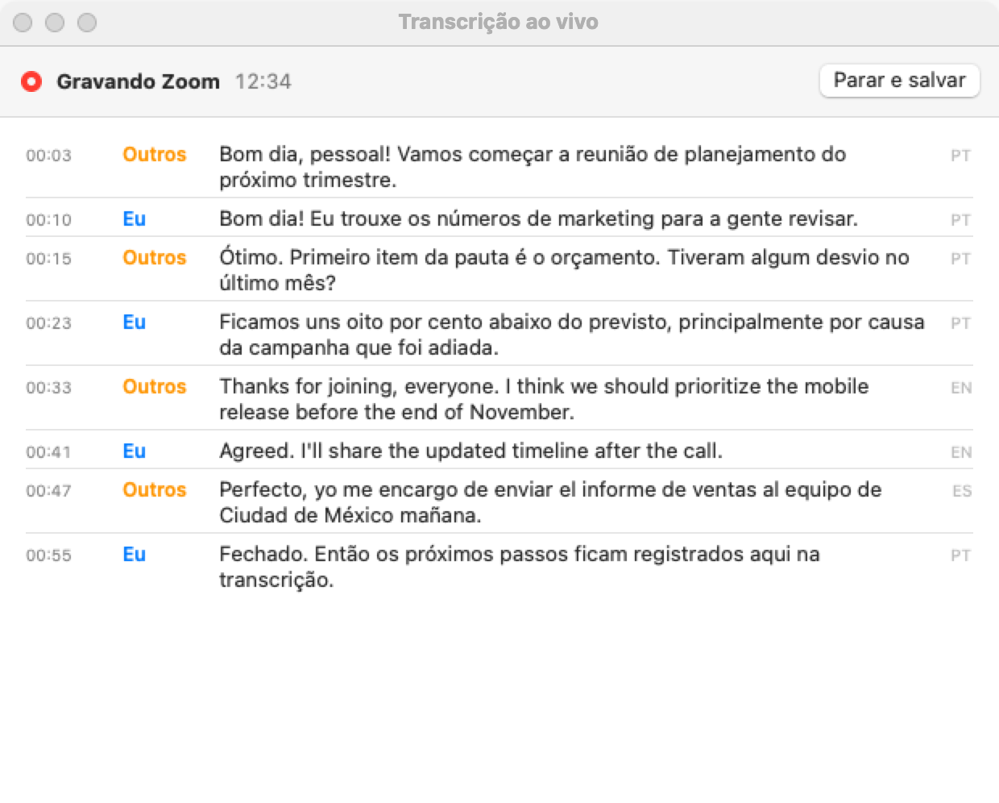
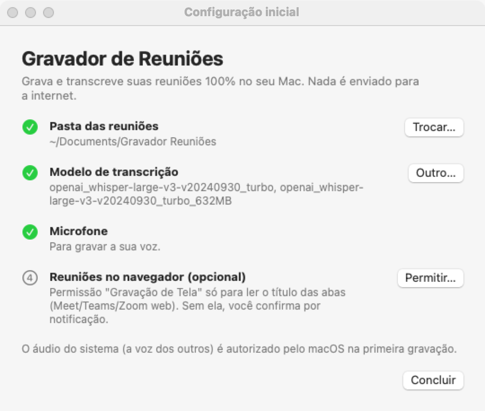
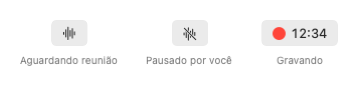
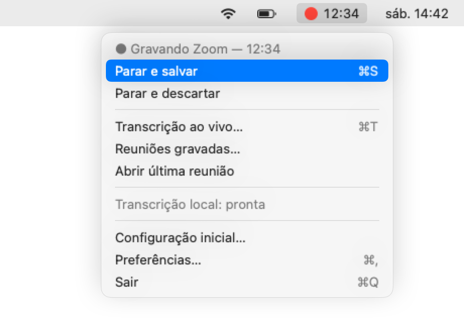
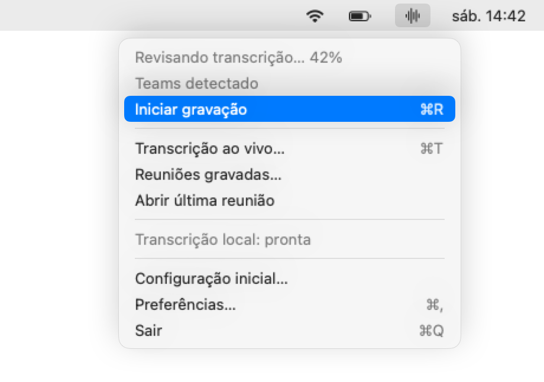
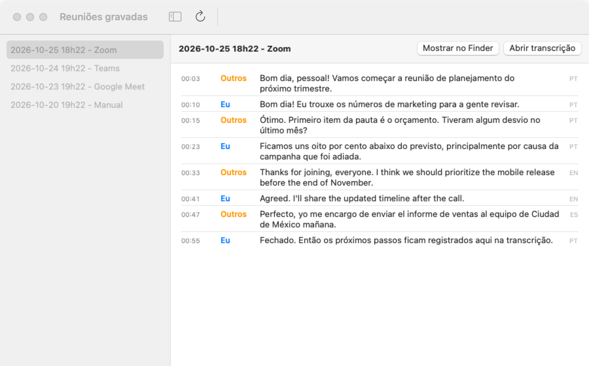
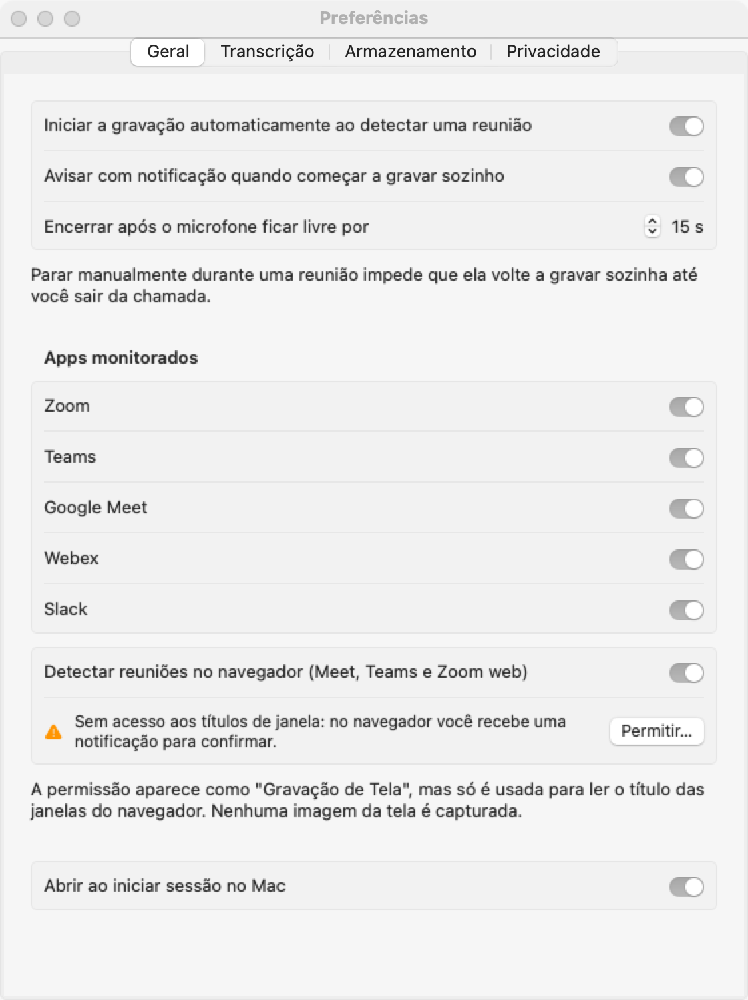
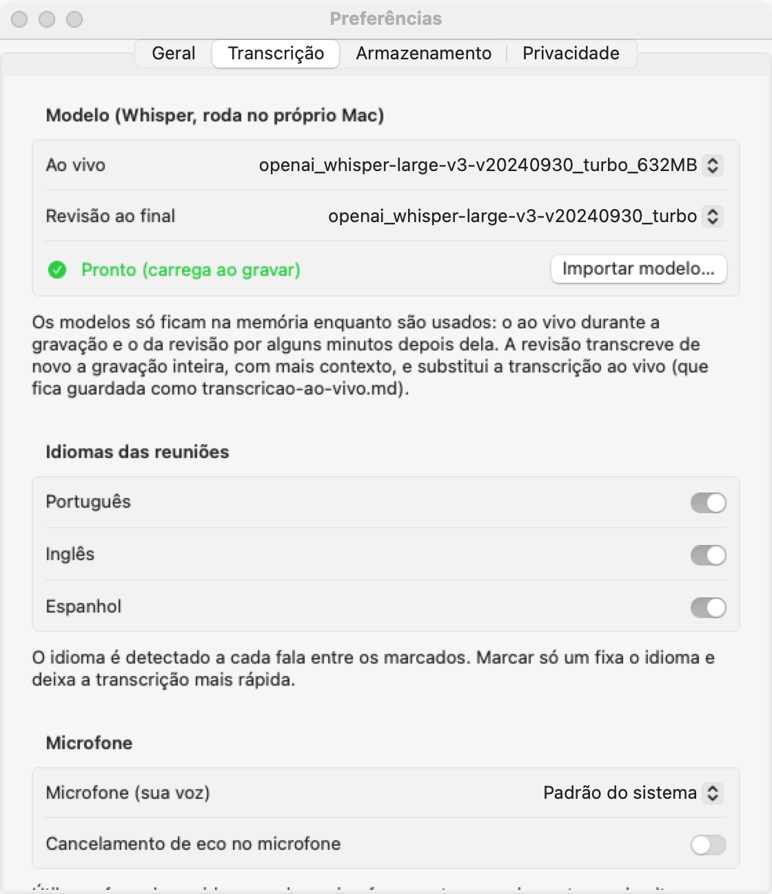
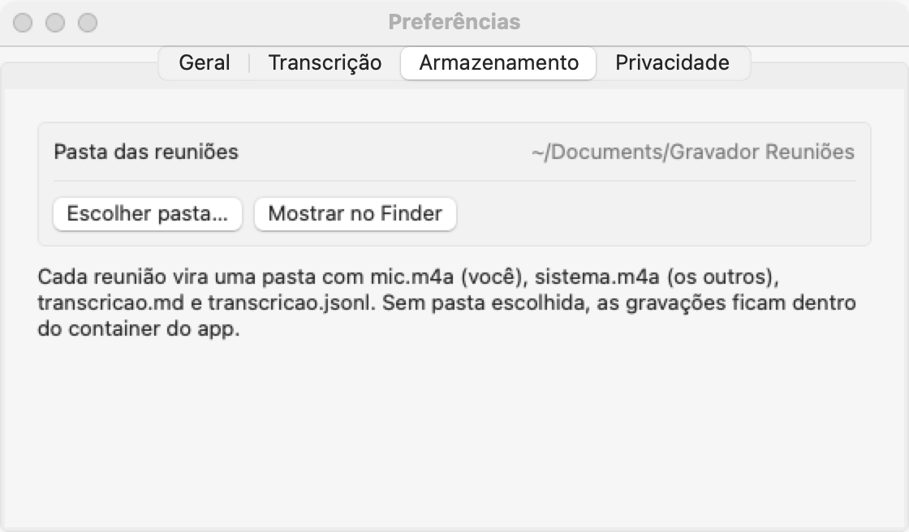
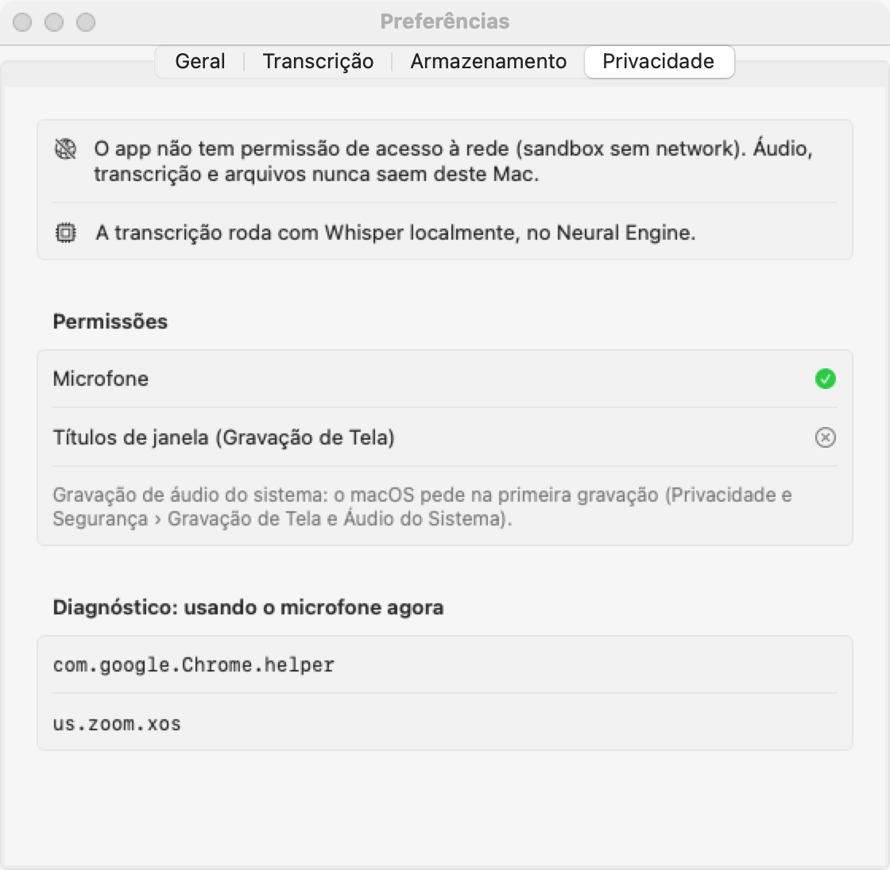

# Gravador de Reuniões

App de barra de menu para macOS que **grava e transcreve em tempo real** reuniões de **Zoom, Microsoft Teams e Google Meet**, tanto no app nativo quanto no navegador. Tudo roda **100% no seu Mac**: o app não tem permissão de acesso à rede, então áudio, transcrição e arquivos nunca saem da máquina.

<p align="center">
  
</p>

- 🎙️ **Início automático:** detecta quando Zoom, Teams, Meet, Webex ou Slack começam a usar o microfone.
- ✋ **Início e parada manuais:** sempre disponíveis no menu. Uma parada manual não é desfeita pela detecção automática.
- 📝 **Transcrição ao vivo e revisão ao final:** usa Whisper large-v3 turbo no Neural Engine. Ao vivo, cada fala aparece em ~1 s; depois da reunião, a gravação inteira é transcrita de novo com mais contexto. Separa **Eu** (seu microfone) de **Outros** (áudio da reunião).
- 🌎 **Português, inglês e espanhol:** o idioma é detectado a cada fala, inclusive em reuniões que misturam idiomas.
- 🔒 **Sem nuvem:** o app roda em sandbox sem permissão de rede, e um script verifica isso.

---

## Sumário

1. [Requisitos](#requisitos)
2. [Instalação](#instalação)
3. [Primeiro uso](#primeiro-uso)
4. [Como usar](#como-usar)
5. [Preferências](#preferências)
6. [Onde ficam as gravações](#onde-ficam-as-gravações)
7. [Consumo de recursos](#consumo-de-recursos)
8. [Privacidade: como garantir que nada vai para a nuvem](#privacidade-como-garantir-que-nada-vai-para-a-nuvem)
9. [Solução de problemas](#solução-de-problemas)
10. [Desenvolvimento](#desenvolvimento)

---

## Requisitos

| | |
|---|---|
| Mac | Apple Silicon (M1 ou mais novo) |
| macOS | 15 (Sequoia) ou mais novo |
| Ferramentas | Xcode 16+ e [Homebrew](https://brew.sh) |
| Espaço | ~2,2 GB para os dois modelos de transcrição, mais ~50 MB por hora de reunião |

## Instalação

### 1. Baixe o código e as ferramentas

```bash
git clone https://github.com/tspineli/gravador.git
cd gravador
brew install xcodegen
```

### 2. Baixe os modelos de transcrição (uma única vez)

```bash
scripts/fetch-model.sh
```

O script baixa dois modelos do Whisper do Hugging Face para `./models/`:

- `openai_whisper-large-v3-v20240930_turbo_632MB` (~0,6 GB): **ao vivo**, durante a reunião;
- `openai_whisper-large-v3-v20240930_turbo` (~1,5 GB): **revisão ao final**.

Esse é o **único** download do processo, e ele roda fora do app. O Gravador nunca acessa a internet.

> Também funciona com um modelo só, usado nas duas etapas. Para baixar só um, passe o nome dele:
> `scripts/fetch-model.sh ./models openai_whisper-large-v3-v20240930_turbo`

### 3. Compile e instale

```bash
scripts/install.sh
```

O script gera o projeto, compila em Release, verifica que o app não tem acesso à rede e o copia para `/Applications`.

**Assinatura:** o `project.yml` usa o Team ID do autor. Escolha uma das opções:

```bash
TEAM=SEU_TEAM_ID scripts/install.sh   # com conta Apple Developer (recomendado)
ADHOC=1 scripts/install.sh            # sem conta: assinatura local
```

Com `ADHOC=1`, o macOS pede as permissões de novo a cada recompilação.

### 4. Abra o app

```bash
open /Applications/Gravador.app
```

O ícone de ondas sonoras aparece na barra de menu. O app não tem ícone no Dock.

## Primeiro uso

Na primeira vez, abre a janela **Configuração inicial**:

<p align="center">
  
</p>

1. **Pasta das reuniões:** escolha onde salvar as gravações (sugestão: `Documentos/Gravador Reuniões`).
2. **Modelos de transcrição:** clique em **Importar…** e selecione `models/openai_whisper-large-v3-v20240930_turbo_632MB`. Depois clique em **Outro…** e selecione `models/openai_whisper-large-v3-v20240930_turbo`. O app copia os modelos para a área dele: o menor vira o modelo ao vivo e o maior, o da revisão. Dá para trocar em Preferências › Transcrição. Depois de importar, apague a pasta `models/` para liberar ~2,2 GB.
3. **Microfone:** clique em **Permitir…** e aceite o pedido do macOS.
4. **Reuniões no navegador (opcional):** permita "Gravação de Tela" para o início automático de Meet, Teams e Zoom no navegador. A permissão serve **só para ler o título das abas**; nenhuma imagem da tela é capturada.

Na primeira gravação, o macOS pede a permissão de **áudio do sistema**, necessária para gravar a voz dos outros participantes.

> A primeira carga de cada modelo leva de 1 a 2 minutos, porque o macOS o compila para o seu chip. Por isso, as primeiras falas da primeira reunião aparecem com atraso, mas nada se perde. Depois disso, cada modelo carrega em cerca de 1 segundo.

Dá para reabrir esta janela pelo menu › **Configuração inicial…**.

## Como usar

### O ícone na barra de menu

<p align="center">
  
</p>

| Ícone | Significado |
|---|---|
| Ondas | Aguardando: monitorando se alguma reunião começa |
| Ondas cortadas | Você parou manualmente; o app não grava de novo até essa reunião terminar |
| ● vermelho + tempo | Gravando |

### Gravação automática

Ao entrar numa reunião, o Gravador começa a gravar sozinho em cerca de 2 segundos e mostra uma notificação. Ao sair da chamada, ele espera 15 segundos (configurável), encerra, termina a transcrição e salva tudo.

| Onde está a reunião | Como é detectada |
|---|---|
| Zoom, Teams, Webex ou Slack (app) | O app de reunião abre o microfone |
| Meet, Teams ou Zoom no navegador (Chrome, Safari, Edge, Brave, Arc, Firefox) | O navegador abre o microfone **e** o título da aba confirma a reunião |
| Navegador **sem** a permissão de títulos | Chega uma notificação **"Reunião no Chrome? Gravar"** e um clique inicia a gravação |

### Parar e iniciar manualmente

Clique no ícone da barra de menu:

<p align="center">
  
  &nbsp;&nbsp;
  
</p>

- **Parar e salvar** (⌘S): encerra e salva áudio e transcrição.
- **Parar e descartar:** encerra e **apaga** tudo o que foi gravado nessa reunião. Use quando você não tiver permissão para gravar.
- **Iniciar gravação** (⌘R): grava na hora, mesmo sem reunião detectada (ex.: uma ligação em outro app). A gravação manual só para quando você mandar.

> **Parou no meio da reunião?** O Gravador **não volta a gravar sozinho** até você sair daquela chamada. A próxima reunião volta a ser gravada automaticamente.

### Transcrição ao vivo

Menu › **Transcrição ao vivo…** (⌘T) abre a janela do topo desta página. Cada fala aparece de 1 a 3 segundos depois de terminar, com horário, quem falou (**Eu** / **Outros**) e o idioma detectado.

### Revisão ao final

Quando a reunião termina, o app transcreve a gravação **de novo**, em segundo plano. Desta vez ele usa o modelo maior e trechos de até 28 s, com o texto anterior como contexto. Isso corrige palavras cortadas e nomes escritos errado ao vivo (ex.: "Timmy de dados" → "time de dados", "deploy de cesta" → "deploy de sexta").

- O menu mostra **Revisando transcrição… 42%**. Leva de 5 a 12 minutos por hora de reunião.
- A versão revisada substitui o `transcricao.md`. A versão ao vivo fica guardada como `transcricao-ao-vivo.md`.
- Se outra reunião começar, a revisão pausa e é retomada depois. Também é retomada se você fechar o app no meio.
- Para desligar: Preferências › Transcrição › Revisão ao final › **Desligada**.

### Reuniões gravadas

Menu › **Reuniões gravadas…** lista as reuniões salvas e mostra a transcrição de cada uma:

<p align="center">
  
</p>

## Preferências

Menu › **Preferências…** (⌘,)

<table>
<tr>
<td width="50%"></td>
<td width="50%"></td>
</tr>
<tr>
<td><b>Geral:</b> liga e desliga o início automático, a notificação, o tempo até encerrar, quais apps monitorar, a detecção no navegador e a abertura junto com o Mac.</td>
<td><b>Transcrição:</b> modelo, idiomas das reuniões, <b>qual microfone gravar</b> e cancelamento de eco.</td>
</tr>
<tr>
<td></td>
<td></td>
</tr>
<tr>
<td><b>Armazenamento:</b> pasta onde as reuniões são salvas.</td>
<td><b>Privacidade:</b> status das permissões e diagnóstico de quais apps estão usando o microfone agora.</td>
</tr>
</table>

Dicas:

- **Escolha o mesmo microfone do Zoom/Teams/Meet** em Transcrição › Microfone. O padrão do sistema pode ser outro dispositivo (ex.: um microfone virtual).
- **Sem fone de ouvido**, o microfone capta a voz dos outros pelo alto-falante. O app descarta automaticamente essas falas repetidas. Se ainda aparecerem, ligue o **Cancelamento de eco**.
- **Reunião só em português?** Deixe só Português marcado. A transcrição fica mais rápida e não confunde com outros idiomas.

## Onde ficam as gravações

Cada reunião vira uma pasta dentro da pasta escolhida:

```
Gravador Reuniões/
└── 2026-10-25 14h30 - Zoom/
    ├── mic.m4a             sua voz
    ├── sistema.m4a         os outros participantes
    ├── transcricao.md      transcrição legível (revisada ao final)
    ├── transcricao.jsonl   um trecho por linha (para scripts)
    ├── transcricao-ao-vivo.md      a versão feita durante a reunião
    └── transcricao-ao-vivo.jsonl
```

Exemplo de `transcricao.md`:

```markdown
# Reunião Zoom — 25/10/2026 14:30

_Início: 25/10/2026 14:30_

**[00:03] Outros:** Bom dia, pessoal! Vamos começar a reunião de planejamento do próximo trimestre.

**[00:10] Eu:** Bom dia! Eu trouxe os números de marketing para a gente revisar.

---
_Fim: 25/10/2026 15:12 · duração 42:10_
```

A transcrição é salva **enquanto** a reunião acontece. Se o Mac travar, o que já foi transcrito não se perde.

## Consumo de recursos

Medido num Mac mini M4 com 16 GB:

| | Parado (só monitorando) | Gravando | Revisão ao final |
|---|---|---|---|
| Memória | ~45 MB | ~0,8 GB (modelo ao vivo) | ~1,6 GB por alguns minutos |
| CPU | ~0,1% | ~7% de um núcleo, com picos a cada fala | Neural Engine + ~1 núcleo |
| Disco | — | ~50 MB por hora | — |

Nenhum modelo fica na memória com o app parado. O modelo ao vivo carrega quando a gravação começa e sai quando ela termina. O da revisão carrega logo depois e também sai ao terminar.

Precisão medida numa reunião sintética de 2,5 min em PT, EN e ES, com ruído e codec de chamada, em taxa de erro por palavra: ao vivo **~1,5–2%**, depois da revisão **~1%**. Áudio real, com pessoas falando ao mesmo tempo, tende a errar mais.

## Privacidade: como garantir que nada vai para a nuvem

Três camadas garantem isso:

1. **Bloqueio pelo macOS:** o app roda no **App Sandbox sem os entitlements `network.client`/`network.server`**. O próprio sistema operacional impede qualquer conexão, inclusive de bibliotecas de terceiros.
2. **Código:** o app não usa nenhuma API de rede.
3. **Execução:** dá para conferir que o processo não abre nenhum socket.

Para verificar as três:

```bash
scripts/verify-no-network.sh /Applications/Gravador.app
```

```
1) Entitlements de /Applications/Gravador.app
  ✅ App Sandbox ligado
  ✅ nenhum entitlement de rede (o macOS bloqueia qualquer conexão)
2) APIs de rede no código do app
  ✅ nenhuma ocorrência de: URLSession, URLRequest, NWConnection, ...
3) Sockets do processo em execução
  ✅ PID 33441 sem nenhum socket de rede

OK: o Gravador não acessa a rede.
```

Também dá para gravar uma reunião com o Wi-Fi desligado: tudo funciona igual.

> ⚖️ **Consentimento:** o Gravador avisa com notificação e mostra o indicador vermelho enquanto grava, mas cabe a você seguir as regras da empresa e da legislação local e avisar os participantes. Na dúvida, use **Parar e descartar**.

## Solução de problemas

| Problema | O que fazer |
|---|---|
| A minha voz não aparece (só "Outros") | Em Preferências › Transcrição, escolha o microfone certo. Confira a permissão em Ajustes do Sistema › Privacidade e Segurança › **Microfone**. |
| A voz dos outros não aparece | Libere o Gravador em Ajustes do Sistema › Privacidade e Segurança › **Gravação de Tela e Áudio do Sistema** › seção "Somente Áudio do Sistema". |
| Não começa a gravar sozinho no navegador | Sem a permissão de títulos, chega uma notificação: clique em **Gravar**. Para iniciar sem confirmar, permita "Gravação de Tela" em Preferências › Geral. |
| Não começa a gravar sozinho num app | Veja em Preferências › Privacidade › Diagnóstico qual bundle ID está usando o microfone e confira se o app está ligado em Preferências › Geral. |
| "Transcrição: nenhum modelo instalado" | Rode `scripts/fetch-model.sh` e importe a pasta em Preferências › Transcrição › **Importar modelo…**. |
| A primeira transcrição demora | É normal na primeira carga de cada modelo (1–2 min) e depois de atualizar o macOS. |
| A transcrição mudou depois da reunião | É a revisão ao final. A versão ao vivo está em `transcricao-ao-vivo.md`. |
| Aparecem falas repetidas como "Eu" | É eco do alto-falante: use fone de ouvido ou ligue o Cancelamento de eco. |

Logs detalhados (inclusive quais apps usam o microfone):

```bash
log stream --info --predicate 'subsystem == "com.tiagospineli.gravador"'
```

## Desenvolvimento

Arquitetura, testes, autotestes e como regenerar estes prints: veja [docs/DESENVOLVIMENTO.md](docs/DESENVOLVIMENTO.md).

### Créditos

- [WhisperKit](https://github.com/argmaxinc/argmax-oss-swift) (MIT): Whisper em Core ML.
- [AudioCap](https://github.com/insidegui/AudioCap) (BSD-2): referência para captura de áudio com Core Audio process taps.
- [OpenAI Whisper](https://github.com/openai/whisper) (MIT): modelo de reconhecimento de fala.
